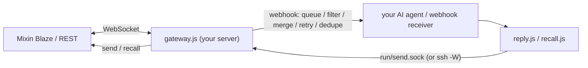

English | [简体中文](README.zh-CN.md)

# mixin-gateway

Keep a [Mixin Messenger](https://mixin.one) bot online and connect it to **your AI agent / webhook receiver**.

## What it is
A small Node.js (≥ 20) service that holds the bot's Blaze WebSocket connection, decrypts incoming messages and forwards
each one as JSON to your webhook. Your agent answers with the bundled CLI senders (`reply.js`, `recall.js`), which
send through the gateway's single connection (local unix socket, or optionally over SSH).



## Features
- Robust Blaze connection: own reconnect backoff with jitter, watchdog, periodic recycle, ACK after handling, dedupe.
- E2E encryption: decrypts `ENCRYPTED_*`; group replies are encrypted to all member sessions.
- Webhook delivery: persistent on-disk queue, retry/backoff (`Retry-After`), category filter, burst coalescing, size cap, sent-id dedupe.
- Structured payloads (V2): attachments (optional download), quotes, stickers, cards, transcripts, sender lookup, context.
- `offline_ms` annotation after outages; auth circuit breaker; heartbeat and member alerts as webhook events.
- Senders: text/post, mentions, stickers, contacts, locations, APP_CARD V0/V1 with covers, buttons, image/video/audio/file, recall.
- Attachment path allowlist (`MIXIN_ATTACH_DIRS`) so a prompt-injected agent cannot upload arbitrary files.
- `systemd --user` units, heartbeat timer, daily health summary. Logs never contain secrets or message bodies.

## Quick start
```bash
git clone <repo-url> mixin-gateway && cd mixin-gateway
npm ci
OFFLINE=1 ./run-tests.sh                          # offline test suite
mkdir -p ~/.mixin-secrets && chmod 700 ~/.mixin-secrets
cp .env.example ~/.mixin-secrets/mixin-gateway.env && chmod 600 ~/.mixin-secrets/mixin-gateway.env
#   set MIXIN_KEYSTORE_JSON (bot keystore from the Mixin developer dashboard), MIXIN_WEBHOOK_URL, MIXIN_WEBHOOK_KEY
cp allowlist.example.json allowlist.json          # Mixin user / conversation uuids that may reach the webhook
deploy/config-check.sh                            # checks names/shapes, never prints values
deploy/ensure-running.sh                          # loads the env file and starts the ./run.sh supervisor
```

## Configuration
Secrets: `MIXIN_KEYSTORE_JSON` (required; `app_id`, `session_id`, `session_private_key`, `server_public_key`),
`MIXIN_WEBHOOK_URL` (required), `MIXIN_WEBHOOK_KEY`. Put them in the env file (`MIXIN_ENV_FILE`, default
`~/.mixin-secrets/mixin-gateway.env`), never in git. All variables (`<gw>` = gateway dir, `<run>` = `<gw>/run`):

| Variable | Default | Notes |
|---|---|---|
| `MIXIN_ALERT_HOST` | hostname |  |
| `MIXIN_ALERT_LOG` | <gw>/… |  |
| `MIXIN_ALERT_RUNBOOK` | docs/operations.md | runbook link put in alerts |  |
| `MIXIN_ALERT_SERVICE` | mixin-gateway.service |  |
| `MIXIN_ALERT_START_GRACE_S` | — |  |
| `MIXIN_ALERT_STATE_FILE` | <run>/… |  |
| `MIXIN_ALERT_TIMEOUT_MS` | 15000 |  |
| `MIXIN_ALERT_URL` | = WEBHOOK_URL | Heartbeat alert target |
| `MIXIN_ALERT_USER` | "" | Alert recipient user id |
| `MIXIN_ALIVE_FILE` | <run>/… |  |
| `MIXIN_ALIVE_STAMP_MS` | 10000 |  |
| `MIXIN_ALLOWLIST_FILE` | <gw>/allowlist.json |  |
| `MIXIN_API_BASE` | Mixin default | tests |
| `MIXIN_ATTACH_DIRS` | built-in | Attachment allowlist dirs (colon-separated) |
| `MIXIN_AUTH_FAIL_LIMIT` | 3 | Auth circuit breaker |
| `MIXIN_AUTH_STATE_FILE` | <run>/… |  |
| `MIXIN_BLAZE_SEND_TIMEOUT_MS` | — |  |
| `MIXIN_BLAZE_SEND_TRIES` | 3 |  |
| `MIXIN_BLAZE_URL` | Mixin default | tests |
| `MIXIN_CONTEXT_DIR` | <gw>/context |  |
| `MIXIN_CONTEXT_ITEM_MAX_CHARS` | 500 |  |
| `MIXIN_CONTEXT_MAX` | 20 |  |
| `MIXIN_CONTEXT_MAX_AGE_MS` | 86400000 |  |
| `MIXIN_CONTEXT_MAX_FILE_BYTES` | 262144 |  |
| `MIXIN_CONTEXT_MAX_TEXT` | 2000 |  |
| `MIXIN_CONV_CACHE_FILE` | <gw>/conv-cache.json |  |
| `MIXIN_ENRICH_TIMEOUT_MS` | 90000 |  |
| `MIXIN_ENV_FILE` | — | deploy scripts |
| `MIXIN_FAKE_SECRET` | — | tests |
| `MIXIN_FORWARD_RECALL` | off |  |
| `MIXIN_FORWARD_SYSTEM` | off |  |
| `MIXIN_GATEWAY_LOG` | <gw>/gateway.log |  |
| `MIXIN_GROUP_ENCRYPT` | on | Group encryption (0 = off) |
| `MIXIN_GROUP_RECALL` | off |  |
| `MIXIN_HEARTBEAT_TIMER` | mixin-gateway-heartbeat.timer |  |
| `MIXIN_KEYSTORE_JSON` | (required, secret) | Bot keystore JSON: app_id, session_id, session_private_key, server_public_key |
| `MIXIN_LOOKUP_CACHE_FILE` | <gw>/lookup-cache.json |  |
| `MIXIN_LOOKUP_TTL_MS` | — |  |
| `MIXIN_MEDIA_DIR` | <gw>/../mixin-media |  |
| `MIXIN_MEDIA_DOWNLOAD` | off |  |
| `MIXIN_MEDIA_MAX_BYTES` | 20971520 |  |
| `MIXIN_MEDIA_TIMEOUT_MS` | 60000 |  |
| `MIXIN_MEDIA_TOTAL_MAX_BYTES` | 1073741824 |  |
| `MIXIN_MEDIA_TTL_MS` | 86400000 |  |
| `MIXIN_MEDIA_TYPES` | built-in |  |
| `MIXIN_MEDIA_VIEW_URL` | — |  |
| `MIXIN_MEMBER_ALERT` | 1 |  |
| `MIXIN_MEMBER_ALERT_DELAY_MS` | 3000 |  |
| `MIXIN_MEMBER_ALERT_RECHECK_MS` | 5000 |  |
| `MIXIN_MEMBER_ALERT_STATE_FILE` | — |  |
| `MIXIN_MIGRATION_MARKER` | deploy/MIGRATED_TO_VPS | optional remote-send marker file |
| `MIXIN_OFFLINE_ANNOTATE_MS` | 600000 | offline_ms window |
| `MIXIN_OFFLINE_THRESHOLD_MS` | 30000 |  |
| `MIXIN_PAYLOAD_LOOKUP` | off |  |
| `MIXIN_PAYLOAD_TEXT_V2` | off |  |
| `MIXIN_PAYLOAD_V2` | off |  |
| `MIXIN_PROBE_TIMEOUT_MS` | 15000 |  |
| `MIXIN_QUEUE_CONCURRENCY` | 4 |  |
| `MIXIN_QUEUE_DIR` | <gw>/queue |  |
| `MIXIN_QUEUE_MAX_AGE_MS` | 604800000 |  |
| `MIXIN_QUEUE_MAX_ATTEMPTS` | 50 |  |
| `MIXIN_QUEUE_MAX_BACKOFF_MS` | 300000 |  |
| `MIXIN_QUEUE_MAX_BYTES` | 52428800 |  |
| `MIXIN_QUEUE_MAX_ITEMS` | 1000 |  |
| `MIXIN_QUEUE_MAX_RECORD_BYTES` | — |  |
| `MIXIN_QUEUE_MAX_RETRY_AFTER_MS` | 900000 |  |
| `MIXIN_QUEUE_SENT_KEEP` | 5000 |  |
| `MIXIN_QUOTE_CACHE_MAX` | 1000 |  |
| `MIXIN_RECEIPT_LOG` | — |  |
| `MIXIN_RECONNECT_JITTER` | 0.5 |  |
| `MIXIN_RECONNECT_MAX_MS` | 60000 |  |
| `MIXIN_RECONNECT_RESET_MS` | 120000 |  |
| `MIXIN_RECYCLE_MS` | 600000 |  |
| `MIXIN_RUN_DIR` | <gw>/run |  |
| `MIXIN_SEEN_FILE` | <gw>/seen.json |  |
| `MIXIN_SEND_ENDPOINT` | local socket | unix:/abs, ssh:host:/abs, 0 |
| `MIXIN_SEND_ENDPOINT_TIMEOUT_MS` | 30000 |  |
| `MIXIN_SEND_ENDPOINT_TRIES` | 3 |  |
| `MIXIN_SEND_SOCKET` | <gw>/run/send.sock |  |
| `MIXIN_SENT_LOG_FILE` | <gw>/sent-log.jsonl |  |
| `MIXIN_SSH_BIN` | ssh |  |
| `MIXIN_SSH_CONNECT_TIMEOUT_S` | 10 |  |
| `MIXIN_SUMMARY_DIR` | <gw>/… | daily summary output |
| `MIXIN_SUMMARY_KEEP_DAYS` | 7 |  |
| `MIXIN_SUMMARY_MAX_QUEUE` | 20 |  |
| `MIXIN_SUMMARY_MAX_RSS_MB` | 200 |  |
| `MIXIN_SUMMARY_MIN_FREE_MB` | 500 |  |
| `MIXIN_SUMMARY_NOW` | — | tests |
| `MIXIN_UPLOAD_MAX_BYTES` | 104857600 |  |
| `MIXIN_USER_AGENT` | Mixin-Node-SDK/7.6.0 |  |
| `MIXIN_WATCHDOG_CHECK_MS` | 20000 |  |
| `MIXIN_WATCHDOG_STALE_MS` | 75000 |  |
| `MIXIN_WEBHOOK_COALESCE_IDLE_MS` | 8000 | Flush after idle |
| `MIXIN_WEBHOOK_COALESCE_MAX` | 20 | Flush at N merged messages |
| `MIXIN_WEBHOOK_COALESCE_MS` | 20000 | Merge window (0 = off) |
| `MIXIN_WEBHOOK_CONTEXT` | off | Attach recent context |
| `MIXIN_WEBHOOK_DROP_CATEGORIES` | MESSAGE_RECALL,MESSAGE_PIN,… | Categories not forwarded |
| `MIXIN_WEBHOOK_KEY` | "" (secret) | Webhook auth key |
| `MIXIN_WEBHOOK_KEY_HEADERS` | Authorization,X-Webhook-Key | Headers carrying the key |
| `MIXIN_WEBHOOK_MAX_BYTES` | 6000 | Max webhook body bytes (<=0 off) |
| `MIXIN_WEBHOOK_MAX_RETRIES` | 8 | Webhook retries |
| `MIXIN_WEBHOOK_QUEUE` | on | Persistent on-disk webhook queue (0 = off) |
| `MIXIN_WEBHOOK_URL` | (required) | Webhook endpoint of your AI agent / receiver |
| `MIXIN_WS_HANDSHAKE_TIMEOUT_MS` | 15000 |  |

## Deploy with systemd --user
```bash
sudo loginctl enable-linger "$USER"
deploy/systemd-user/install-units.sh --start      # gateway + heartbeat timer + daily summary timer
systemctl --user status mixin-gateway
journalctl --user -u mixin-gateway -f
```
Units assume the checkout at `~/mixin-gateway` and Node at `~/.local/opt/node/bin` or `/usr/bin`; edit
`deploy/systemd-user/*.service` otherwise. A system-wide unit is in `deploy/mixin-gateway.service`
(`deploy/install-systemd.sh`). Upgrade, rollback and remote send via SSH: [docs/operations.md](docs/operations.md).

## Webhook format
One JSON POST per message, idempotent `message_id`, key in `Authorization: Bearer` / `X-Webhook-Key`:
```json
{"conversation_id":"…","user_id":"…","message_id":"…","category":"PLAIN_TEXT","original_category":"ENCRYPTED_TEXT",
 "encrypted":true,"text":"hello","created_at":"2026-01-01T00:00:00.000Z"}
```
Bursts may arrive merged (`merged_count`, `merged_messages`); after outages `offline_ms` is added; alerts carry
`kind`. Full schema: [docs/webhook.md](docs/webhook.md).

## Sending replies and cards
```bash
node reply.js --conversation <conv-uuid> --reply-to <message_id> --user <sender-uuid> --text "Hi!"
node reply.js --conversation <conv-uuid> --reply-to <message_id> --image ~/mixin-media/chart.png --caption "Chart"
node reply.js --conversation <conv-uuid> --reply-to <message_id> --card @card.json
node recall.js --help
node reply.js --help                               # all flags
```
Reply ids are derived from `--reply-to` (UUIDv5), so retries never double-send. Card rules (V0/V1, `shareable`,
resource patterns, cover sizing with `tools/card-cover.py`): [docs/cards.md](docs/cards.md).

## Troubleshooting
| Symptom | Check |
|---|---|
| exits with 78 at start | env/keystore missing or invalid → `deploy/config-check.sh` |
| no webhooks | sender in `allowlist.json`? `tail gateway.log`; `node gateway-status.js`; queue size in `queue/` |
| `AUTH circuit open` in log | keystore/session revoked → fix `MIXIN_KEYSTORE_JSON`, restart |
| `ENDPOINT_UNAVAILABLE` from reply.js | gateway not running / Blaze not connected; `run/send.sock` exists; SSH reachability for remote send |
| encrypted group messages fail | `node check-encryption.js`; members on old clients → `member_alert` |
| messages stolen / missing | two gateways for one session — run exactly one |
| card shows nothing / image missing | see [docs/cards.md](docs/cards.md) (`shareable`, resource patterns, cover size) |

## Tests
`OFFLINE=1 ./run-tests.sh` — all offline with fakes. Without `OFFLINE=1`, `test-crypto.js` makes one read-only
request with the real keystore.

## Contributing
See [CONTRIBUTING.md](CONTRIBUTING.md). Security reports: [SECURITY.md](SECURITY.md). Changes: [CHANGELOG.md](CHANGELOG.md).

## License
[MIT](LICENSE) © 2026 mixin-gateway contributors
