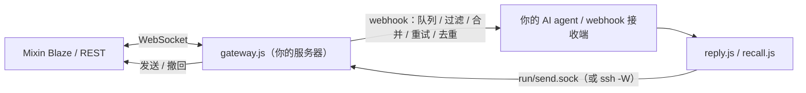

[English](README.md) | 简体中文

# mixin-gateway

让 [Mixin Messenger](https://mixin.one) 机器人保持在线，并把它接到**你的 AI agent / webhook 接收端**。

## 这是什么
一个小型 Node.js（≥ 20）服务：维持机器人的 Blaze WebSocket 连接，解密收到的消息，并把每条消息以 JSON 转发到你的
webhook。你的 agent 用自带的 CLI 发送工具（`reply.js`、`recall.js`）回复，它们通过网关唯一的连接发送（本地 unix
socket，或可选地经由 SSH）。



## 功能
- 稳健的 Blaze 连接：自带带抖动的重连退避、看门狗、定期重建连接、处理后再 ACK、去重。
- 端到端加密：解密 `ENCRYPTED_*`；群回复加密发送给所有成员会话。
- Webhook 投递：持久化磁盘队列、重试/退避（遵循 `Retry-After`）、类别过滤、连发合并、大小上限、已发送 id 去重。
- 结构化 payload（V2）：附件（可选下载）、引用、贴纸、卡片、聊天记录、发送者查询、上下文。
- 故障后的 `offline_ms` 标注；鉴权熔断；心跳告警与成员告警以 webhook 事件发送。
- 发送：文本/文章、@提及、贴纸、名片、位置、带封面的 APP_CARD V0/V1、按钮、图片/视频/音频/文件、撤回。
- 附件路径白名单（`MIXIN_ATTACH_DIRS`），被提示注入的 agent 无法上传任意文件。
- `systemd --user` 单元、心跳定时器、每日健康摘要。日志从不包含密钥或消息正文。

## 快速开始
```bash
git clone <repo-url> mixin-gateway && cd mixin-gateway
npm ci
OFFLINE=1 ./run-tests.sh                          # 离线测试
mkdir -p ~/.mixin-secrets && chmod 700 ~/.mixin-secrets
cp .env.example ~/.mixin-secrets/mixin-gateway.env && chmod 600 ~/.mixin-secrets/mixin-gateway.env
#   填写 MIXIN_KEYSTORE_JSON（Mixin 开发者后台的机器人 keystore）、MIXIN_WEBHOOK_URL、MIXIN_WEBHOOK_KEY
cp allowlist.example.json allowlist.json          # 允许到达 webhook 的 Mixin 用户 / 会话 uuid
deploy/config-check.sh                            # 只检查名称/格式，从不打印值
deploy/ensure-running.sh                          # 加载 env 文件并启动 ./run.sh 守护进程
```

## 配置
密钥：`MIXIN_KEYSTORE_JSON`（必填；`app_id`、`session_id`、`session_private_key`、`server_public_key`）、
`MIXIN_WEBHOOK_URL`（必填）、`MIXIN_WEBHOOK_KEY`。放在 env 文件中（`MIXIN_ENV_FILE`，默认
`~/.mixin-secrets/mixin-gateway.env`），切勿提交到 git。全部变量（`<gw>` = 网关目录，`<run>` = `<gw>/run`）：

| 变量 | 默认值 | 说明 |
|---|---|---|
| `MIXIN_ALERT_HOST` | hostname |  |
| `MIXIN_ALERT_LOG` | <gw>/… |  |
| `MIXIN_ALERT_RUNBOOK` | docs/operations.md | runbook link put in alerts |  |
| `MIXIN_ALERT_SERVICE` | mixin-gateway.service |  |
| `MIXIN_ALERT_START_GRACE_S` | — |  |
| `MIXIN_ALERT_STATE_FILE` | <run>/… |  |
| `MIXIN_ALERT_TIMEOUT_MS` | 15000 |  |
| `MIXIN_ALERT_URL` | = WEBHOOK_URL | Heartbeat alert target |
| `MIXIN_ALERT_USER` | "" | Alert recipient user id |
| `MIXIN_ALIVE_FILE` | <run>/… |  |
| `MIXIN_ALIVE_STAMP_MS` | 10000 |  |
| `MIXIN_ALLOWLIST_FILE` | <gw>/allowlist.json |  |
| `MIXIN_API_BASE` | Mixin default | tests |
| `MIXIN_ATTACH_DIRS` | built-in | Attachment allowlist dirs (colon-separated) |
| `MIXIN_AUTH_FAIL_LIMIT` | 3 | Auth circuit breaker |
| `MIXIN_AUTH_STATE_FILE` | <run>/… |  |
| `MIXIN_BLAZE_SEND_TIMEOUT_MS` | — |  |
| `MIXIN_BLAZE_SEND_TRIES` | 3 |  |
| `MIXIN_BLAZE_URL` | Mixin default | tests |
| `MIXIN_CONTEXT_DIR` | <gw>/context |  |
| `MIXIN_CONTEXT_ITEM_MAX_CHARS` | 500 |  |
| `MIXIN_CONTEXT_MAX` | 20 |  |
| `MIXIN_CONTEXT_MAX_AGE_MS` | 86400000 |  |
| `MIXIN_CONTEXT_MAX_FILE_BYTES` | 262144 |  |
| `MIXIN_CONTEXT_MAX_TEXT` | 2000 |  |
| `MIXIN_CONV_CACHE_FILE` | <gw>/conv-cache.json |  |
| `MIXIN_ENRICH_TIMEOUT_MS` | 90000 |  |
| `MIXIN_ENV_FILE` | — | deploy scripts |
| `MIXIN_FAKE_SECRET` | — | tests |
| `MIXIN_FORWARD_RECALL` | off |  |
| `MIXIN_FORWARD_SYSTEM` | off |  |
| `MIXIN_GATEWAY_LOG` | <gw>/gateway.log |  |
| `MIXIN_GROUP_ENCRYPT` | on | Group encryption (0 = off) |
| `MIXIN_GROUP_RECALL` | off |  |
| `MIXIN_HEARTBEAT_TIMER` | mixin-gateway-heartbeat.timer |  |
| `MIXIN_KEYSTORE_JSON` | (required, secret) | Bot keystore JSON: app_id, session_id, session_private_key, server_public_key |
| `MIXIN_LOOKUP_CACHE_FILE` | <gw>/lookup-cache.json |  |
| `MIXIN_LOOKUP_TTL_MS` | — |  |
| `MIXIN_MEDIA_DIR` | <gw>/../mixin-media |  |
| `MIXIN_MEDIA_DOWNLOAD` | off |  |
| `MIXIN_MEDIA_MAX_BYTES` | 20971520 |  |
| `MIXIN_MEDIA_TIMEOUT_MS` | 60000 |  |
| `MIXIN_MEDIA_TOTAL_MAX_BYTES` | 1073741824 |  |
| `MIXIN_MEDIA_TTL_MS` | 86400000 |  |
| `MIXIN_MEDIA_TYPES` | built-in |  |
| `MIXIN_MEDIA_VIEW_URL` | — |  |
| `MIXIN_MEMBER_ALERT` | 1 |  |
| `MIXIN_MEMBER_ALERT_DELAY_MS` | 3000 |  |
| `MIXIN_MEMBER_ALERT_RECHECK_MS` | 5000 |  |
| `MIXIN_MEMBER_ALERT_STATE_FILE` | — |  |
| `MIXIN_MIGRATION_MARKER` | deploy/MIGRATED_TO_VPS | optional remote-send marker file |
| `MIXIN_OFFLINE_ANNOTATE_MS` | 600000 | offline_ms window |
| `MIXIN_OFFLINE_THRESHOLD_MS` | 30000 |  |
| `MIXIN_PAYLOAD_LOOKUP` | off |  |
| `MIXIN_PAYLOAD_TEXT_V2` | off |  |
| `MIXIN_PAYLOAD_V2` | off |  |
| `MIXIN_PROBE_TIMEOUT_MS` | 15000 |  |
| `MIXIN_QUEUE_CONCURRENCY` | 4 |  |
| `MIXIN_QUEUE_DIR` | <gw>/queue |  |
| `MIXIN_QUEUE_MAX_AGE_MS` | 604800000 |  |
| `MIXIN_QUEUE_MAX_ATTEMPTS` | 50 |  |
| `MIXIN_QUEUE_MAX_BACKOFF_MS` | 300000 |  |
| `MIXIN_QUEUE_MAX_BYTES` | 52428800 |  |
| `MIXIN_QUEUE_MAX_ITEMS` | 1000 |  |
| `MIXIN_QUEUE_MAX_RECORD_BYTES` | — |  |
| `MIXIN_QUEUE_MAX_RETRY_AFTER_MS` | 900000 |  |
| `MIXIN_QUEUE_SENT_KEEP` | 5000 |  |
| `MIXIN_QUOTE_CACHE_MAX` | 1000 |  |
| `MIXIN_RECEIPT_LOG` | — |  |
| `MIXIN_RECONNECT_JITTER` | 0.5 |  |
| `MIXIN_RECONNECT_MAX_MS` | 60000 |  |
| `MIXIN_RECONNECT_RESET_MS` | 120000 |  |
| `MIXIN_RECYCLE_MS` | 600000 |  |
| `MIXIN_RUN_DIR` | <gw>/run |  |
| `MIXIN_SEEN_FILE` | <gw>/seen.json |  |
| `MIXIN_SEND_ENDPOINT` | local socket | unix:/abs, ssh:host:/abs, 0 |
| `MIXIN_SEND_ENDPOINT_TIMEOUT_MS` | 30000 |  |
| `MIXIN_SEND_ENDPOINT_TRIES` | 3 |  |
| `MIXIN_SEND_SOCKET` | <gw>/run/send.sock |  |
| `MIXIN_SENT_LOG_FILE` | <gw>/sent-log.jsonl |  |
| `MIXIN_SSH_BIN` | ssh |  |
| `MIXIN_SSH_CONNECT_TIMEOUT_S` | 10 |  |
| `MIXIN_SUMMARY_DIR` | <gw>/… | daily summary output |
| `MIXIN_SUMMARY_KEEP_DAYS` | 7 |  |
| `MIXIN_SUMMARY_MAX_QUEUE` | 20 |  |
| `MIXIN_SUMMARY_MAX_RSS_MB` | 200 |  |
| `MIXIN_SUMMARY_MIN_FREE_MB` | 500 |  |
| `MIXIN_SUMMARY_NOW` | — | tests |
| `MIXIN_UPLOAD_MAX_BYTES` | 104857600 |  |
| `MIXIN_USER_AGENT` | Mixin-Node-SDK/7.6.0 |  |
| `MIXIN_WATCHDOG_CHECK_MS` | 20000 |  |
| `MIXIN_WATCHDOG_STALE_MS` | 75000 |  |
| `MIXIN_WEBHOOK_COALESCE_IDLE_MS` | 8000 | Flush after idle |
| `MIXIN_WEBHOOK_COALESCE_MAX` | 20 | Flush at N merged messages |
| `MIXIN_WEBHOOK_COALESCE_MS` | 20000 | Merge window (0 = off) |
| `MIXIN_WEBHOOK_CONTEXT` | off | Attach recent context |
| `MIXIN_WEBHOOK_DROP_CATEGORIES` | MESSAGE_RECALL,MESSAGE_PIN,… | Categories not forwarded |
| `MIXIN_WEBHOOK_KEY` | "" (secret) | Webhook auth key |
| `MIXIN_WEBHOOK_KEY_HEADERS` | Authorization,X-Webhook-Key | Headers carrying the key |
| `MIXIN_WEBHOOK_MAX_BYTES` | 6000 | Max webhook body bytes (<=0 off) |
| `MIXIN_WEBHOOK_MAX_RETRIES` | 8 | Webhook retries |
| `MIXIN_WEBHOOK_QUEUE` | on | Persistent on-disk webhook queue (0 = off) |
| `MIXIN_WEBHOOK_URL` | (required) | Webhook endpoint of your AI agent / receiver |
| `MIXIN_WS_HANDSHAKE_TIMEOUT_MS` | 15000 |  |

## 使用 systemd --user 部署
```bash
sudo loginctl enable-linger "$USER"
deploy/systemd-user/install-units.sh --start      # 网关 + 心跳定时器 + 每日摘要定时器
systemctl --user status mixin-gateway
journalctl --user -u mixin-gateway -f
```
单元文件假定代码位于 `~/mixin-gateway`，Node 位于 `~/.local/opt/node/bin` 或 `/usr/bin`；否则请修改
`deploy/systemd-user/*.service`。系统级单元见 `deploy/mixin-gateway.service`（`deploy/install-systemd.sh`）。
升级、回滚与经由 SSH 远程发送：[docs/operations.md](docs/operations.md)。

## Webhook 格式
每条消息一个 JSON POST，`message_id` 幂等，密钥放在 `Authorization: Bearer` / `X-Webhook-Key`：
```json
{"conversation_id":"…","user_id":"…","message_id":"…","category":"PLAIN_TEXT","original_category":"ENCRYPTED_TEXT",
 "encrypted":true,"text":"hello","created_at":"2026-01-01T00:00:00.000Z"}
```
连发消息可能被合并（`merged_count`、`merged_messages`）；故障恢复后会附加 `offline_ms`；告警带有 `kind`。
完整结构：[docs/webhook.md](docs/webhook.md)。

## 发送回复与卡片
```bash
node reply.js --conversation <conv-uuid> --reply-to <message_id> --user <sender-uuid> --text "Hi!"
node reply.js --conversation <conv-uuid> --reply-to <message_id> --image ~/mixin-media/chart.png --caption "Chart"
node reply.js --conversation <conv-uuid> --reply-to <message_id> --card @card.json
node recall.js --help
node reply.js --help                               # 全部参数
```
回复 id 由 `--reply-to` 派生（UUIDv5），重试不会重复发送。卡片规则（V0/V1、`shareable`、resource patterns、
用 `tools/card-cover.py` 调整封面尺寸）：[docs/cards.md](docs/cards.md)。

## 故障排查
| 现象 | 检查 |
|---|---|
| 启动时以 78 退出 | env/keystore 缺失或无效 → `deploy/config-check.sh` |
| 收不到 webhook | 发送者在 `allowlist.json` 中？`tail gateway.log`；`node gateway-status.js`；`queue/` 积压 |
| 日志出现 `AUTH circuit open` | keystore/会话被撤销 → 修复 `MIXIN_KEYSTORE_JSON` 后重启 |
| reply.js 报 `ENDPOINT_UNAVAILABLE` | 网关未运行 / Blaze 未连接；`run/send.sock` 是否存在；远程发送时 SSH 是否可达 |
| 加密群消息失败 | `node check-encryption.js`；成员使用旧客户端 → `member_alert` |
| 消息被抢 / 丢失 | 同一会话运行了两个网关 —— 只能运行一个 |
| 卡片不显示 / 图片缺失 | 见 [docs/cards.md](docs/cards.md)（`shareable`、resource patterns、封面尺寸） |

## 测试
`OFFLINE=1 ./run-tests.sh` —— 全部离线，使用假服务。不加 `OFFLINE=1` 时 `test-crypto.js` 会用真实 keystore
发起一次只读请求。

## 贡献
见 [CONTRIBUTING.md](CONTRIBUTING.md)。安全问题：[SECURITY.md](SECURITY.md)。变更记录：[CHANGELOG.md](CHANGELOG.md)。

## 许可证
[MIT](LICENSE) © 2026 mixin-gateway contributors
